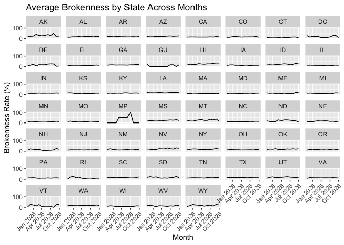
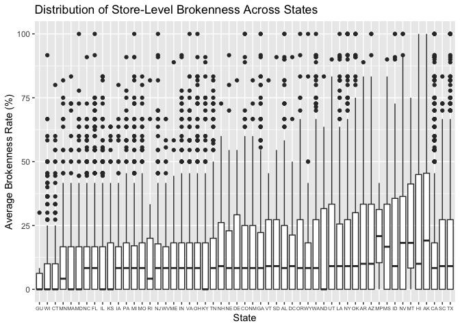
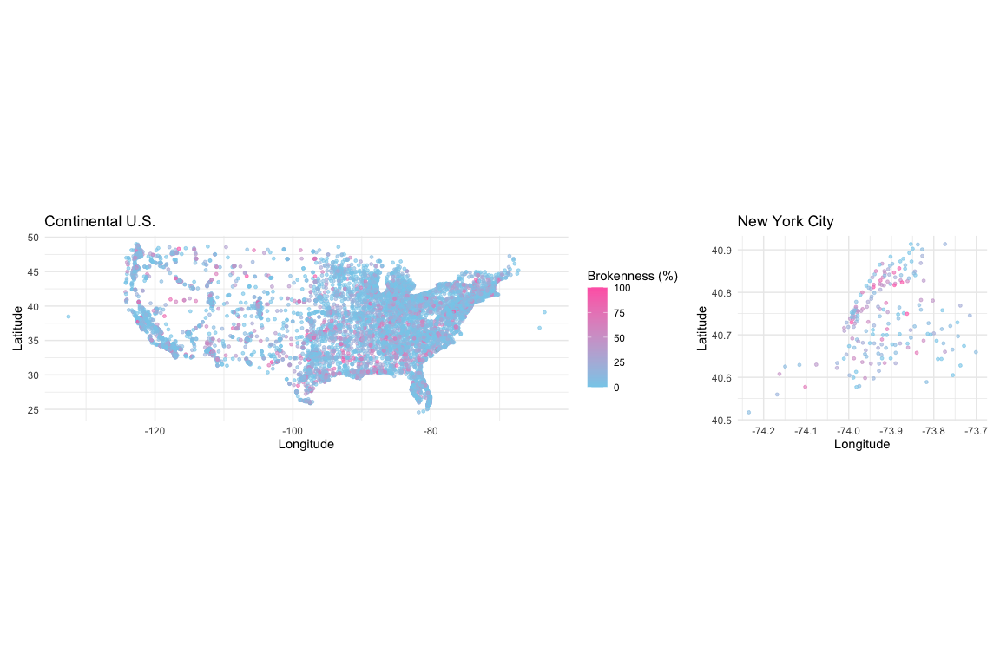

McHeartbreaking: Patterns in McDonald’s McFlurry Machine Brokenness
================
Amy Hodges
November 17th, 2026

### Introduction

This report analyzes monthly McDonald’s McFlurry machine status from
November 2025 through October 2026 in the United States. Store-level
analyses are combined with location and region information to explore
brokenness, changes over time, and geographic patterns. Brokenness is
analyzed only for observations marked active; missing status records are
not included.

### Data Cleaning & Overview

``` r
# Importing all monthly datasets
monthly_mcbroken <- list.files(
  path = "mcbroken_data",
  pattern = NULL,
  full.names = TRUE
  )

# Combining monthly datasets
mcbroken_raw <- map_dfr(monthly_mcbroken, read_csv)

# Widening date variable and changing variable types
mcbroken_clean <- mcbroken_raw %>%
  mutate(
    year = substr(month, 1, 4),
    month = substr(month, 6, 7),
    across(
      c(month, store_id, year),
           as.factor),
  )

# Importing store information datasets
store_info <- read_csv("store_data/store_info.csv")
state_regions <- read_csv("store_data/state_regions.csv")

# Matching variable types before joining
store_info <- store_info %>%
  mutate(
    across(
      c(store_id, state, city),
      as.factor)
    )

state_regions <- state_regions %>%
  mutate(
    across(
      c(state, region),
      as.factor)
    )

# Joining McBroken and store information datasets
mcbroken_clean <- mcbroken_clean %>%
  left_join(store_info, by = "store_id") %>%
  left_join(state_regions, by = "state")

# Store quantification
n_stores = n_distinct(mcbroken_clean$store_id)

state_store_counts <- mcbroken_clean %>% 
  count(state, sort = TRUE)

state_most_machines <- state_store_counts %>%
  slice_head(n=1)
state_most_machines
```

    ## # A tibble: 1 × 2
    ##   state     n
    ##   <fct> <int>
    ## 1 CA    14743

``` r
state_least_machines <- state_store_counts %>%
  slice_tail(n=1)
state_least_machines
```

    ## # A tibble: 1 × 2
    ##   state     n
    ##   <fct> <int>
    ## 1 MP       24

``` r
# Overall brokenness rate among active machines
brokenness_rate_overall <- mcbroken_clean %>%
  summarise(
    status_number = sum(!is.na(active)),
    active_number = sum(active %in% TRUE, na.rm = TRUE),
    inactive_number = sum(active %in% FALSE, na.rm = TRUE),
    broken_number = sum(broken %in% TRUE, na.rm = TRUE),
    broken_rate_overall = 100*broken_number/active_number,
  )
brokenness_rate_overall
```

    ## # A tibble: 1 × 5
    ##   status_number active_number inactive_number broken_number broken_rate_overall
    ##           <int>         <int>           <int>         <int>               <dbl>
    ## 1        151179        151113              66         21826                14.4

To clean this data, I first imported and merged the monthly McFlurry
machine status datasets and separated the date variable into month and
year. After importing store information datasets and adjusting all
variable types appropriately, I merged the McFlurry machine status and
store information datasets into one dataframe. The resulting cleaned
dataframe includes a total of 163203 observations across 11 variables,
including McFlurry machine status and brokenness, date, and store
location information.

There are data on McFlurry machines at 13792 different McDonald’s
locations in the U.S., with California having the most stores at 14743
and the Northern Mariana Islands having the least at 24. The overall
rate of brokenness of active McFlurry machines across all U.S.
McDonald’s locations between November 2025 and October 2026 was 14.44%.

### Exploratory Analysis

#### McDonald’s Locations with Unusual Stats

``` r
# Checking for stores with very few observations
stores_obs_count <- mcbroken_clean %>% 
  count(store_id, sort = TRUE)

stores_least_obs <- stores_obs_count %>%
  slice_tail(n=20)

stores_least_obs
```

    ## # A tibble: 20 × 2
    ##    store_id     n
    ##    <fct>    <int>
    ##  1 58523942     1
    ##  2 58704102     1
    ##  3 68511183     1
    ##  4 69020232     1
    ##  5 73260200     1
    ##  6 75988973     1
    ##  7 77190555     1
    ##  8 78159568     1
    ##  9 80560257     1
    ## 10 80812138     1
    ## 11 82341179     1
    ## 12 84752369     1
    ## 13 84890895     1
    ## 14 90062419     1
    ## 15 90199064     1
    ## 16 91144285     1
    ## 17 91811163     1
    ## 18 91911815     1
    ## 19 96767040     1
    ## 20 99184432     1

``` r
# Checking for high rates of inactivity/brokenness at stores with at least 9 observations
store_observations <- mcbroken_clean %>%
  group_by(store_id) %>%
  summarise(
    observations = n(),
    status_n = sum(!is.na(active)),
    active_n = sum(active %in% TRUE, na.rm = TRUE),
    inactive_n = sum(active %in% FALSE, na.rm = TRUE),
    broken_n = sum(broken %in% TRUE, na.rm = TRUE),
    inactive_rate = if_else(status_n > 0, inactive_n / status_n, NA),
    broken_rate = if_else(active_n > 0, broken_n / active_n, NA),
    .groups = "drop"
  ) %>%
  left_join(store_info, by = "store_id")

# Checking how many stores have less than 9 observations
few_obs_stores <- store_observations %>% filter(observations < 9)

# Stores with highest inactivity rates
super_inactive_stores <- store_observations %>%
  filter(status_n >= 9) %>%
  arrange(desc(inactive_rate)) %>%
  slice_head(n=10) %>%
  rename(
    `Store ID` = store_id, 
    `Observations` = observations, 
    `Statuses` = status_n, 
    `Active Machines` = active_n, 
    `Inactive Machines` = inactive_n, 
    `Broken Machines` = broken_n, 
    `Inactivity Rate` = inactive_rate, 
    `Brokenness Rate` = broken_rate, 
    `Longitude` = longitude, 
    `Latitude` = latitude, 
    `State` = state, 
    `City` = city, 
    `Street Address` = street
    ) %>%
  kable(digits = 2, caption = "Locations with the highest inactivity rates (at least nine observed statuses)")

super_inactive_stores
```

| Store ID | Observations | Statuses | Active Machines | Inactive Machines | Broken Machines | Inactivity Rate | Brokenness Rate | Longitude | Latitude | State | City | Street Address |
|:---|---:|---:|---:|---:|---:|---:|---:|---:|---:|:---|:---|:---|
| 10435749 | 12 | 10 | 1 | 9 | 0 | 0.90 | 0.00 | -63.50 | 39.10 | CT | Windsor Locks | MOWGLY LAB |
| 19584360 | 12 | 12 | 2 | 10 | 0 | 0.83 | 0.00 | -85.85 | 34.49 | AL | Rainsville | 32 Main St W |
| 29488174 | 12 | 11 | 2 | 9 | 0 | 0.82 | 0.00 | -104.67 | 39.86 | CO | Denver | Denver Airport - DEN CONC B |
| 91277728 | 12 | 9 | 2 | 7 | 0 | 0.78 | 0.00 | -81.73 | 26.21 | FL | Naples | 6065 Pine Ridge Rd |
| 49765416 | 12 | 11 | 3 | 8 | 0 | 0.73 | 0.00 | -85.51 | 34.87 | GA | Trenton | 5316 Ga Hwy 136 W |
| 96139117 | 12 | 11 | 3 | 8 | 3 | 0.73 | 1.00 | -73.86 | 40.75 | NY | Corona | 40-12 National St |
| 20555386 | 12 | 11 | 6 | 5 | 1 | 0.45 | 0.17 | -82.66 | 38.49 | KY | Ashland | 351 RIVER HILL ROAD (Walmart) |
| 11762713 | 12 | 11 | 7 | 4 | 2 | 0.36 | 0.29 | -85.69 | 32.42 | AL | Tuskegee | 401 W Martin Luther King Hwy |
| 60675729 | 12 | 9 | 7 | 2 | 0 | 0.22 | 0.00 | -98.50 | 29.37 | TX | San Antonio | 1643 Pleasanton Road |
| 94624290 | 12 | 10 | 9 | 1 | 1 | 0.10 | 0.11 | -73.95 | 40.81 | NY | New York | 354 W 125th St |

Locations with the highest inactivity rates (at least nine observed
statuses)

``` r
# Stores with highest brokenness rates
super_broke_stores <- store_observations %>%
  filter(active_n >= 9) %>%
  arrange(desc(broken_rate)) %>%
  slice_head(n=10) %>%
  rename(
    `Store ID` = store_id, 
    `Observations` = observations, 
    `Statuses` = status_n, 
    `Active Machines` = active_n, 
    `Inactive Machines` = inactive_n, 
    `Broken Machines` = broken_n, 
    `Inactivity Rate` = inactive_rate, 
    `Brokenness Rate` = broken_rate,
    `Longitude` = longitude, 
    `Latitude` = latitude, 
    `State` = state, 
    `City` = city, 
    `Street Address` = street
    ) %>%
  kable(digits = 2, caption = "Locations with the highest brokenness rates (at least nine active observations)")

super_broke_stores
```

| Store ID | Observations | Statuses | Active Machines | Inactive Machines | Broken Machines | Inactivity Rate | Brokenness Rate | Longitude | Latitude | State | City | Street Address |
|:---|---:|---:|---:|---:|---:|---:|---:|---:|---:|:---|:---|:---|
| 10649691 | 12 | 12 | 12 | 0 | 12 | 0 | 1 | -149.82 | 61.22 | AK | Anchorage | 3006 Mountain View Dr |
| 11343808 | 12 | 12 | 12 | 0 | 12 | 0 | 1 | -73.29 | 40.82 | NY | Commack | 2 Vanderbilt Pkwy |
| 11365554 | 12 | 11 | 11 | 0 | 11 | 0 | 1 | -73.94 | 40.81 | NY | New York | 444 Lenox Ave |
| 12287315 | 12 | 12 | 12 | 0 | 12 | 0 | 1 | -117.16 | 32.88 | CA | San Diego | 7140 Miramar Road |
| 14163925 | 12 | 12 | 12 | 0 | 12 | 0 | 1 | -75.93 | 42.10 | NY | Binghamton | 167 Main St |
| 17584283 | 12 | 10 | 10 | 0 | 10 | 0 | 1 | -74.16 | 40.73 | NJ | Newark | 7944 Penn Station |
| 17774683 | 12 | 10 | 10 | 0 | 10 | 0 | 1 | -74.36 | 42.95 | NY | Fultonville | 37 Riverside Dr |
| 19807113 | 12 | 9 | 9 | 0 | 9 | 0 | 1 | -122.92 | 46.15 | WA | Longview | 729 Ocean Beach Highway |
| 20135742 | 12 | 9 | 9 | 0 | 9 | 0 | 1 | -106.69 | 44.35 | WY | Buffalo | 480 E Hart St |
| 20136963 | 12 | 11 | 11 | 0 | 11 | 0 | 1 | -111.91 | 33.47 | AZ | Scottsdale | 1516 N Hayden Rd |

Locations with the highest brokenness rates (at least nine active
observations)

Of 13792 stores, 239 have fewer than nine monthly records. Some
locations have high inactivity or brokenness rates (shown in the tables
above) but these rates may be more extreme due to a small number of
observed active statuses.

#### Analysis of the McDonald’s Closest to Mailman School of Public Health

``` r
# Distance calculation to Mailman School of Public Health
mailman_lat <- 40.8426
mailman_lon <- -73.9431

mailman_distance <- function(lat, lon) {
  6371 * 2 * asin(sqrt(
    sin((lat - mailman_lat) * pi / 360)^2 +
      cos(mailman_lat * pi / 180) * cos(lat * pi / 180) *
      sin((lon - mailman_lon) * pi / 360)^2
  ))
}

# Identifying the closest store
closest_store_mailman <- store_observations %>%
  filter(!is.na(latitude), !is.na(longitude)) %>%
  mutate(distance_km = mailman_distance(latitude, longitude)) %>%
  slice_min(distance_km, n = 1)

# Creating a table of closest store's information
closest_store_table <- closest_store_mailman %>%
  select(store_id, street, city, state, distance_km, observations, inactive_rate, broken_rate) %>%
  rename(
    `Store ID` = store_id, 
    `Street Address` = street, 
    `City` = city, 
    `State` = state, 
    `Distance (km)` = distance_km, 
    `Observations` = observations, 
    `Inactivity Rate` = inactive_rate, 
    `Brokenness Rate` = broken_rate
    ) %>%
  kable(digits = 2, caption = "McDonald's location closest to Mailman School of Public Health")
closest_store_table
```

| Store ID | Street Address | City | State | Distance (km) | Observations | Inactivity Rate | Brokenness Rate |
|:---|:---|:---|:---|---:|---:|---:|---:|
| 40651456 | 4040 Broadway | New York | NY | 0.35 | 12 | 0 | 0.08 |

McDonald’s location closest to Mailman School of Public Health

``` r
# Creating a table of closest store's machine status over time
closest_store_status_table <- mcbroken_clean %>%
  filter(store_id == closest_store_mailman$store_id) %>%
  arrange(month) %>%
  select(month, active, broken) %>%
  rename(
    `Month` = month, 
    `Machine Active?` = active, 
    `Machine Broken?` = broken
    ) %>%
  kable(caption = "Monthly McFlurry machine status at the McDonald's closest to Mailman School of Public Health")
closest_store_table 
```

| Store ID | Street Address | City | State | Distance (km) | Observations | Inactivity Rate | Brokenness Rate |
|:---|:---|:---|:---|---:|---:|---:|---:|
| 40651456 | 4040 Broadway | New York | NY | 0.35 | 12 | 0 | 0.08 |

McDonald’s location closest to Mailman School of Public Health

The nearest store to the Mailman School of Public Health is 4040
Broadway, New York, approximately 0.35 km away. This location’s McFlurry
machine was both active and working over the entire time period of the
dataset.

#### NYC McDonald’s Locations with Highest Brokenness Rates

``` r
# Filtering most broken NYC locations and creating a table
nyc_stores <- store_observations %>%
  filter(state == "NY",
         between(longitude, -74.26, -73.7),
         between(latitude, 40.5, 40.92),
         active_n >= 9) %>%
  arrange(desc(broken_rate)) 

nyc_stores_table <- nyc_stores %>%
  select(street, city, observations, active_n, broken_n, broken_rate) %>%
  slice_head(n = 10) %>%
  rename(
    `Street Address` = street, 
    `City` = city, 
    `Observations` = observations, 
    `Active Machines` = active_n, 
    `Broken Machines` = broken_n, 
    `Brokenness Rate` = broken_rate
    ) %>%
  kable(digits = 2, caption = "NYC locations with the highest brokenness rates (at least nine active observations)")

nyc_stores_table
```

| Street Address | City | Observations | Active Machines | Broken Machines | Brokenness Rate |
|:---|:---|---:|---:|---:|---:|
| 444 Lenox Ave | New York | 12 | 11 | 11 | 1.00 |
| 875 Garrison Ave | Bronx | 12 | 11 | 11 | 1.00 |
| 1600 Bruckner Blvd | Bronx | 12 | 9 | 9 | 1.00 |
| 724 Broadway | New York | 12 | 11 | 11 | 1.00 |
| 2505 Southern Blvd | Bronx | 12 | 12 | 11 | 0.92 |
| 599 E Tremont Ave | Bronx | 12 | 12 | 10 | 0.83 |
| 51-67 E 161st St | Bronx | 12 | 11 | 9 | 0.82 |
| 39 Union Sq W | New York | 12 | 12 | 9 | 0.75 |
| 159-40 Cross Bay Blvd | Howard Beach | 12 | 12 | 9 | 0.75 |
| 54-29 Metropolitan Ave | Ridgewood | 12 | 11 | 8 | 0.73 |

NYC locations with the highest brokenness rates (at least nine active
observations)

#### Machine Breaking and Fixing Month-to-Month

``` r
break_fix_data <- mcbroken_clean %>%
  mutate(status = case_when(
    active %in% TRUE & broken %in% TRUE ~ "Broken",
    active %in% TRUE & broken %in% FALSE ~ "Working",
    .default = NA)
    ) %>%
  arrange(store_id, year, month) %>%
  group_by(store_id) %>%
  mutate(previous_status = lag(status)) %>%
  ungroup()

break_fix_table <- break_fix_data %>%
  filter(!is.na(previous_status), !is.na(status)) %>%
  count(previous_status, status) %>%
  complete(previous_status = c("Working", "Broken"),
           status = c("Working", "Broken"), fill = list(n = 0)) %>%
  pivot_wider(names_from = status, values_from = n) %>%
  arrange(factor(previous_status, levels = c("Working", "Broken")))

break_fix_table %>% 
  rename(
    `Previous Status` = previous_status
    ) %>%
  kable(caption = "Machine status changes between months")
```

| Previous Status | Broken | Working |
|:----------------|-------:|--------:|
| Working         |   8176 |  101446 |
| Broken          |  10521 |    7918 |

Machine status changes between months

#### Average Brokenness by Region and Month

``` r
# Calculating average brokenness by region and month
region_month_broken <- mcbroken_clean %>%
  group_by(region, year, month) %>%
  summarise(
    broken = sum(broken %in% TRUE, na.rm = TRUE),
    active = sum(active %in% TRUE, na.rm = TRUE),
    average_brokenness = 100*broken / active,
    .groups = "drop"
  )

# Creating a table
region_month_broken_table <- region_month_broken %>%
  rename(
    `Region` = region, 
    `Year` = year, 
    `Month` = month, 
    `Broken Machines` = broken, 
    `Active Machines` = active, 
    `Average Brokenness Rate` = average_brokenness) %>%
  kable(digits = 3, caption = "Average brokenness by region and month")

region_month_broken_table
```

| Region | Year | Month | Broken Machines | Active Machines | Average Brokenness Rate |
|:---|:---|:---|---:|---:|---:|
| Alaska | 2025 | 11 | 4 | 20 | 20.000 |
| Alaska | 2025 | 12 | 5 | 25 | 20.000 |
| Alaska | 2026 | 01 | 5 | 23 | 21.739 |
| Alaska | 2026 | 02 | 10 | 26 | 38.462 |
| Alaska | 2026 | 03 | 6 | 23 | 26.087 |
| Alaska | 2026 | 04 | 8 | 25 | 32.000 |
| Alaska | 2026 | 05 | 7 | 25 | 28.000 |
| Alaska | 2026 | 06 | 9 | 25 | 36.000 |
| Alaska | 2026 | 07 | 6 | 23 | 26.087 |
| Alaska | 2026 | 08 | 11 | 23 | 47.826 |
| Alaska | 2026 | 09 | 4 | 26 | 15.385 |
| Alaska | 2026 | 10 | 4 | 25 | 16.000 |
| Hawaii | 2025 | 11 | 15 | 62 | 24.194 |
| Hawaii | 2025 | 12 | 11 | 67 | 16.418 |
| Hawaii | 2026 | 01 | 13 | 69 | 18.841 |
| Hawaii | 2026 | 02 | 13 | 67 | 19.403 |
| Hawaii | 2026 | 03 | 18 | 66 | 27.273 |
| Hawaii | 2026 | 04 | 15 | 64 | 23.438 |
| Hawaii | 2026 | 05 | 13 | 61 | 21.311 |
| Hawaii | 2026 | 06 | 15 | 60 | 25.000 |
| Hawaii | 2026 | 07 | 15 | 60 | 25.000 |
| Hawaii | 2026 | 08 | 18 | 63 | 28.571 |
| Hawaii | 2026 | 09 | 22 | 67 | 32.836 |
| Hawaii | 2026 | 10 | 21 | 66 | 31.818 |
| Northeast | 2025 | 11 | 260 | 2005 | 12.968 |
| Northeast | 2025 | 12 | 287 | 2046 | 14.027 |
| Northeast | 2026 | 01 | 335 | 2070 | 16.184 |
| Northeast | 2026 | 02 | 298 | 2069 | 14.403 |
| Northeast | 2026 | 03 | 267 | 2024 | 13.192 |
| Northeast | 2026 | 04 | 235 | 2009 | 11.697 |
| Northeast | 2026 | 05 | 235 | 2023 | 11.616 |
| Northeast | 2026 | 06 | 248 | 1936 | 12.810 |
| Northeast | 2026 | 07 | 227 | 1919 | 11.829 |
| Northeast | 2026 | 08 | 268 | 1964 | 13.646 |
| Northeast | 2026 | 09 | 349 | 2041 | 17.099 |
| Northeast | 2026 | 10 | 279 | 2046 | 13.636 |
| Northern Rockies and Plains | 2025 | 11 | 31 | 200 | 15.500 |
| Northern Rockies and Plains | 2025 | 12 | 29 | 199 | 14.573 |
| Northern Rockies and Plains | 2026 | 01 | 30 | 204 | 14.706 |
| Northern Rockies and Plains | 2026 | 02 | 38 | 208 | 18.269 |
| Northern Rockies and Plains | 2026 | 03 | 40 | 193 | 20.725 |
| Northern Rockies and Plains | 2026 | 04 | 36 | 192 | 18.750 |
| Northern Rockies and Plains | 2026 | 05 | 38 | 206 | 18.447 |
| Northern Rockies and Plains | 2026 | 06 | 36 | 192 | 18.750 |
| Northern Rockies and Plains | 2026 | 07 | 36 | 177 | 20.339 |
| Northern Rockies and Plains | 2026 | 08 | 34 | 191 | 17.801 |
| Northern Rockies and Plains | 2026 | 09 | 43 | 200 | 21.500 |
| Northern Rockies and Plains | 2026 | 10 | 30 | 205 | 14.634 |
| Northwest | 2025 | 11 | 66 | 431 | 15.313 |
| Northwest | 2025 | 12 | 73 | 428 | 17.056 |
| Northwest | 2026 | 01 | 71 | 441 | 16.100 |
| Northwest | 2026 | 02 | 81 | 443 | 18.284 |
| Northwest | 2026 | 03 | 78 | 441 | 17.687 |
| Northwest | 2026 | 04 | 81 | 440 | 18.409 |
| Northwest | 2026 | 05 | 85 | 446 | 19.058 |
| Northwest | 2026 | 06 | 83 | 422 | 19.668 |
| Northwest | 2026 | 07 | 62 | 404 | 15.347 |
| Northwest | 2026 | 08 | 81 | 450 | 18.000 |
| Northwest | 2026 | 09 | 97 | 464 | 20.905 |
| Northwest | 2026 | 10 | 81 | 451 | 17.960 |
| Ohio Valley | 2025 | 11 | 296 | 2423 | 12.216 |
| Ohio Valley | 2025 | 12 | 337 | 2480 | 13.589 |
| Ohio Valley | 2026 | 01 | 318 | 2501 | 12.715 |
| Ohio Valley | 2026 | 02 | 302 | 2473 | 12.212 |
| Ohio Valley | 2026 | 03 | 318 | 2414 | 13.173 |
| Ohio Valley | 2026 | 04 | 289 | 2409 | 11.997 |
| Ohio Valley | 2026 | 05 | 291 | 2423 | 12.010 |
| Ohio Valley | 2026 | 06 | 305 | 2354 | 12.957 |
| Ohio Valley | 2026 | 07 | 308 | 2350 | 13.106 |
| Ohio Valley | 2026 | 08 | 287 | 2364 | 12.140 |
| Ohio Valley | 2026 | 09 | 371 | 2493 | 14.882 |
| Ohio Valley | 2026 | 10 | 321 | 2476 | 12.964 |
| South | 2025 | 11 | 303 | 1923 | 15.757 |
| South | 2025 | 12 | 336 | 1943 | 17.293 |
| South | 2026 | 01 | 312 | 1980 | 15.758 |
| South | 2026 | 02 | 326 | 1971 | 16.540 |
| South | 2026 | 03 | 337 | 1926 | 17.497 |
| South | 2026 | 04 | 321 | 1918 | 16.736 |
| South | 2026 | 05 | 320 | 1911 | 16.745 |
| South | 2026 | 06 | 354 | 1880 | 18.830 |
| South | 2026 | 07 | 333 | 1839 | 18.108 |
| South | 2026 | 08 | 361 | 1905 | 18.950 |
| South | 2026 | 09 | 387 | 2003 | 19.321 |
| South | 2026 | 10 | 384 | 2021 | 19.000 |
| Southeast | 2025 | 11 | 246 | 2433 | 10.111 |
| Southeast | 2025 | 12 | 326 | 2497 | 13.056 |
| Southeast | 2026 | 01 | 341 | 2530 | 13.478 |
| Southeast | 2026 | 02 | 313 | 2506 | 12.490 |
| Southeast | 2026 | 03 | 332 | 2461 | 13.490 |
| Southeast | 2026 | 04 | 303 | 2430 | 12.469 |
| Southeast | 2026 | 05 | 320 | 2469 | 12.961 |
| Southeast | 2026 | 06 | 314 | 2405 | 13.056 |
| Southeast | 2026 | 07 | 327 | 2369 | 13.803 |
| Southeast | 2026 | 08 | 340 | 2430 | 13.992 |
| Southeast | 2026 | 09 | 395 | 2509 | 15.743 |
| Southeast | 2026 | 10 | 372 | 2536 | 14.669 |
| Southwest | 2025 | 11 | 94 | 654 | 14.373 |
| Southwest | 2025 | 12 | 123 | 656 | 18.750 |
| Southwest | 2026 | 01 | 132 | 681 | 19.383 |
| Southwest | 2026 | 02 | 113 | 675 | 16.741 |
| Southwest | 2026 | 03 | 107 | 649 | 16.487 |
| Southwest | 2026 | 04 | 104 | 662 | 15.710 |
| Southwest | 2026 | 05 | 116 | 658 | 17.629 |
| Southwest | 2026 | 06 | 123 | 640 | 19.219 |
| Southwest | 2026 | 07 | 121 | 629 | 19.237 |
| Southwest | 2026 | 08 | 110 | 638 | 17.241 |
| Southwest | 2026 | 09 | 140 | 700 | 20.000 |
| Southwest | 2026 | 10 | 125 | 693 | 18.038 |
| Upper Midwest | 2025 | 11 | 117 | 1087 | 10.764 |
| Upper Midwest | 2025 | 12 | 158 | 1112 | 14.209 |
| Upper Midwest | 2026 | 01 | 143 | 1130 | 12.655 |
| Upper Midwest | 2026 | 02 | 110 | 1115 | 9.865 |
| Upper Midwest | 2026 | 03 | 99 | 1078 | 9.184 |
| Upper Midwest | 2026 | 04 | 100 | 1094 | 9.141 |
| Upper Midwest | 2026 | 05 | 97 | 1097 | 8.842 |
| Upper Midwest | 2026 | 06 | 109 | 1068 | 10.206 |
| Upper Midwest | 2026 | 07 | 107 | 1042 | 10.269 |
| Upper Midwest | 2026 | 08 | 111 | 1080 | 10.278 |
| Upper Midwest | 2026 | 09 | 164 | 1112 | 14.748 |
| Upper Midwest | 2026 | 10 | 143 | 1114 | 12.837 |
| US Territories | 2025 | 11 | 1 | 7 | 14.286 |
| US Territories | 2025 | 12 | 0 | 8 | 0.000 |
| US Territories | 2026 | 01 | 0 | 8 | 0.000 |
| US Territories | 2026 | 02 | 0 | 8 | 0.000 |
| US Territories | 2026 | 03 | 1 | 7 | 14.286 |
| US Territories | 2026 | 04 | 1 | 8 | 12.500 |
| US Territories | 2026 | 05 | 1 | 7 | 14.286 |
| US Territories | 2026 | 06 | 1 | 8 | 12.500 |
| US Territories | 2026 | 07 | 2 | 7 | 28.571 |
| US Territories | 2026 | 08 | 1 | 7 | 14.286 |
| US Territories | 2026 | 09 | 0 | 8 | 0.000 |
| US Territories | 2026 | 10 | 1 | 8 | 12.500 |
| West | 2025 | 11 | 174 | 1251 | 13.909 |
| West | 2025 | 12 | 190 | 1287 | 14.763 |
| West | 2026 | 01 | 186 | 1298 | 14.330 |
| West | 2026 | 02 | 180 | 1273 | 14.140 |
| West | 2026 | 03 | 180 | 1250 | 14.400 |
| West | 2026 | 04 | 181 | 1259 | 14.376 |
| West | 2026 | 05 | 180 | 1263 | 14.252 |
| West | 2026 | 06 | 186 | 1238 | 15.024 |
| West | 2026 | 07 | 195 | 1215 | 16.049 |
| West | 2026 | 08 | 174 | 1223 | 14.227 |
| West | 2026 | 09 | 245 | 1306 | 18.760 |
| West | 2026 | 10 | 218 | 1299 | 16.782 |

Average brokenness by region and month

### Visualizations

#### Average Brokenness by State Across Months

``` r
# Calculating average brokenness by state
state_month_broken <- mcbroken_clean %>%
  group_by(state, year, month) %>%
  summarise(
    broken = sum(broken %in% TRUE, na.rm = TRUE),
    active = sum(active %in% TRUE, na.rm = TRUE),
    average_brokenness = 100 * broken / active,
    .groups = "drop"
  ) %>%
  mutate(date = as.Date(paste(year, month, "01", sep = "-")))

# Plotting
state_month_broken_plot <- ggplot(
  state_month_broken, 
  aes(x = date, y = average_brokenness)) +
  geom_line() +
  facet_wrap(~state) +
  scale_y_continuous(breaks = c(0, 100), limits = c(0, 100)) +
  labs(
    title = "Average Brokenness by State Across Months",
    x = "Month",
    y = "Brokenness Rate (%)"
  ) +
  theme(
    axis.text.x = element_text(angle = 45, hjust = 1),
    panel.spacing = grid::unit(0.5, "lines")
  )

state_month_broken_plot
```

<!-- -->

### Average Brokenness Across States

``` r
# Calculating average brokenness 
store_avg_brokenness <- mcbroken_clean %>%
  group_by(store_id, state) %>%
  summarise(
    broken = sum(broken %in% TRUE, na.rm = TRUE),
    active = sum(active %in% TRUE, na.rm = TRUE),
    average_brokenness = 100 * broken / active,
    .groups = "drop"
  )

# Plotting
avg_broken_state_plot <- ggplot(
  store_avg_brokenness, 
  aes(x = reorder(state, average_brokenness), y = average_brokenness)) +
  geom_boxplot() +
  labs(
    title = "Distribution of Store-Level Brokenness Across States",
    x = "State",
    y = "Average Brokenness Rate (%)"
  ) +
  theme(
  axis.text.x = element_text(size = 5.5)
)

avg_broken_state_plot
```

<!-- -->

### 

``` r
# Merging datasets
store_avg_brokenness_map <- store_avg_brokenness %>%
  left_join(
    store_info %>% select(store_id, latitude, longitude),
    by = "store_id"
  )

# Filtering stores in continental US
continental_stores <- store_avg_brokenness_map %>%
  filter(
    !state %in% c("AK", "HI", "GU", "PR", "VI", "MP", "AS"),
    !is.na(latitude),
    !is.na(longitude)
  ) %>%
  mutate(panel = "Continental U.S.")

# Filtering stores in NYC
nyc_map_stores <- store_avg_brokenness_map %>%
  filter(
    state == "NY",
    between(longitude, -74.26, -73.7),
    between(latitude, 40.5, 40.92),
    !is.na(latitude),
    !is.na(longitude)
  ) %>%
  mutate(panel = "New York City")

# Combine the two panels into one dataset
two_panel_stores <- bind_rows(continental_stores, nyc_map_stores)

# Continental U.S. plot
continental_plot_panel <- ggplot(
  continental_stores,
  aes(
    x = longitude, 
    y = latitude, 
    color = average_brokenness)) +
  geom_point(alpha = 0.6, size = 1) +
  scale_color_gradient(
    low = "skyblue", 
    high = "hotpink",
    limits = c(0, 100)) +
  coord_fixed() +
  labs(title = "Continental U.S.",
       x = "Longitude",
       y = "Latitude",
       color = "Brokenness (%)") +
  theme_minimal()

# NYC plot
nyc_plot_panel <- ggplot(
  nyc_map_stores,
  aes(
    x = longitude,
    y = latitude,
    color = average_brokenness)) +
  geom_point(alpha = 0.6, size = 1) +
  scale_color_gradient(
    low = "skyblue", 
    high = "hotpink",
    limits = c(0, 100)) +
  coord_fixed() +
  labs(title = "New York City",
       x = "Longitude",
       y = "Latitude",
       color = "Brokenness (%)") +
  theme_minimal() +
  theme(legend.position = "none")

# Combining the two panels into one plot
two_panel_stores_plot <- continental_plot_panel + nyc_plot_panel
two_panel_stores_plot
```

<!-- -->
